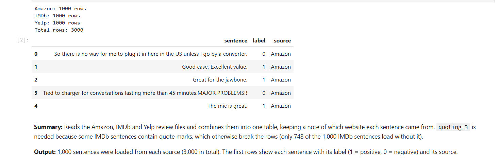
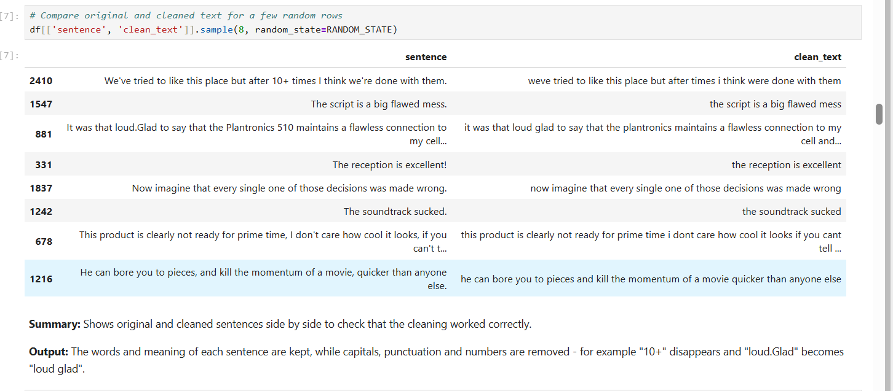
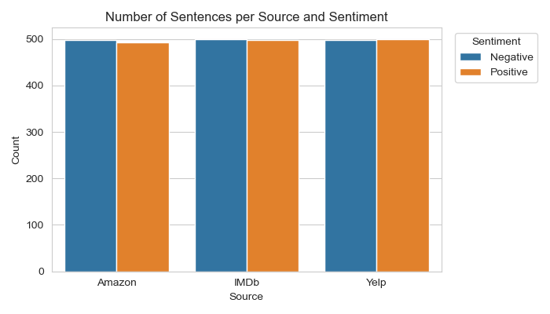
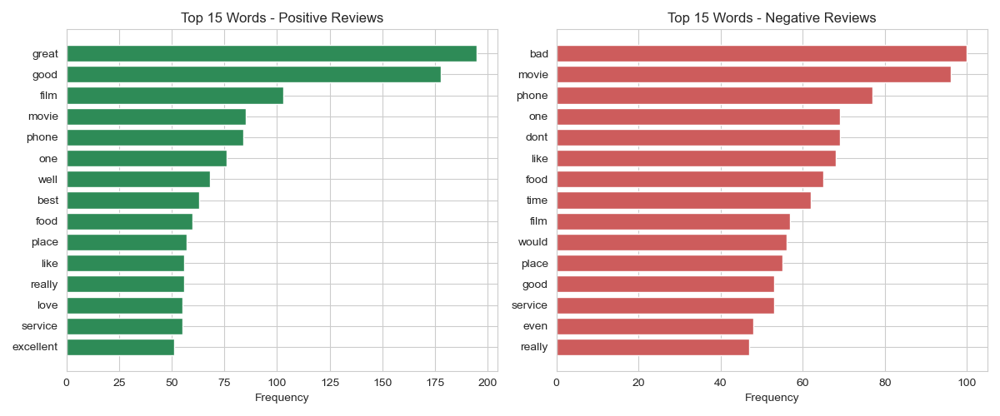
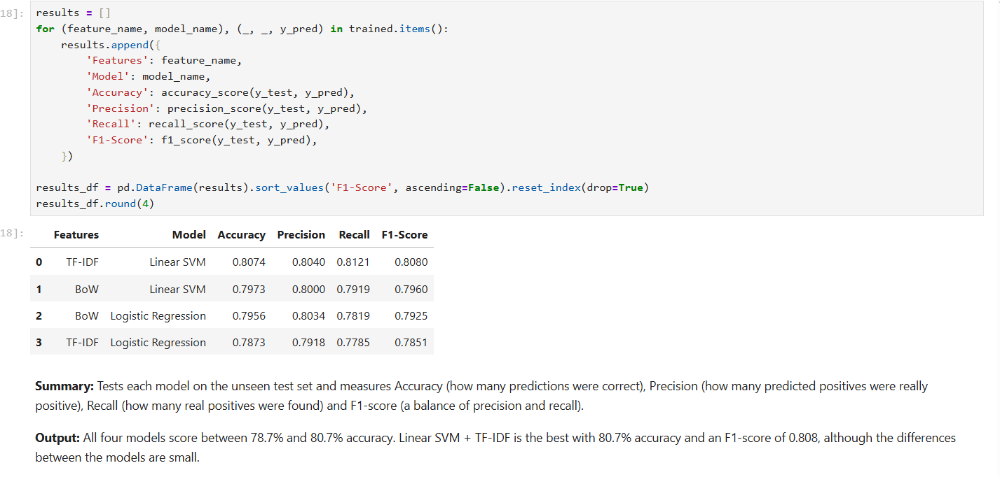
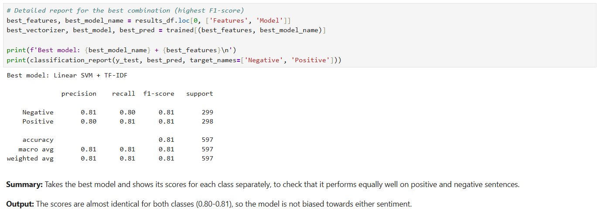
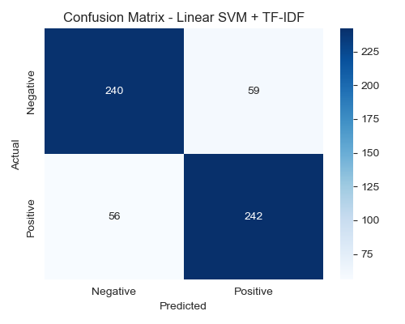
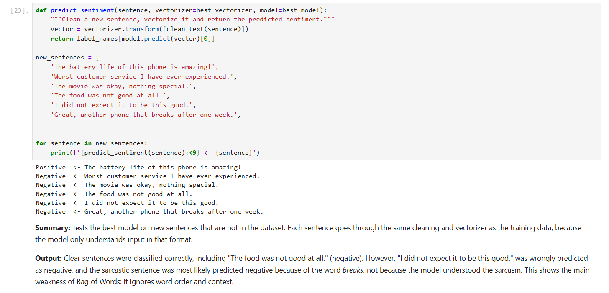

# Lab 01 - Sentiment Analysis Using Traditional Machine Learning

## Laboratory Session

**Lab Number:** 01  
**Title:** Sentiment Analysis Using Traditional Machine Learning  
**Topic:** Text Preprocessing, TF-IDF and Machine Learning  
**Duration:** 1 Hour

## Objective

The objective of this lab is to practise basic NLP tasks by building a sentiment analysis model with traditional machine learning. The lab covers cleaning text data, exploring it, converting text into numerical features (Bag of Words / TF-IDF) and training a classifier to predict whether a sentence is positive or negative.

## Dataset

**Sentiment Labelled Sentences** - UCI Machine Learning Repository
https://archive.ics.uci.edu/dataset/331/sentiment+labelled+sentences

The dataset contains 3,000 sentences taken from Amazon, IMDb and Yelp reviews (1,000 from each). Each sentence is labelled as `1` (positive) or `0` (negative). The files are stored in the [data/](data/) folder.

## Tools and Libraries

- Python
- Pandas, NumPy
- NLTK
- Scikit-learn
- Matplotlib, Seaborn

## Tasks and Implementation

Notebook: [Lab01_Sentiment_Analysis.ipynb](notebook/Lab01_Sentiment_Analysis.ipynb)

| Step | Task | What was done |
|------|------|---------------|
| 1 | Load the dataset | Loaded the three tab-separated files with Pandas and combined them into one DataFrame. Removed 17 duplicate sentences. |
| 2 | Text preprocessing | Lowercased the text, removed punctuation and numbers, removed extra whitespace and stored the result in a `clean_text` column. |
| 3 | Explore the data | Displayed positive and negative examples, found the most frequent words (excluding stopwords) and compared the two classes. |
| 4 | Split the dataset | 80% training (2,385) / 20% testing (597), stratified by label. |
| 5 | Bag of Words | Created BoW features with `CountVectorizer` (4,460-word vocabulary) and TF-IDF features with `TfidfVectorizer`. |
| 6 | Train models | Trained Logistic Regression and Linear SVM on both feature types. |
| 7 | Evaluate | Calculated Accuracy, Precision, Recall and F1-score, and plotted a confusion matrix for the best model. |
| 8 | Test new sentences | Predicted the sentiment of six new sentences, including negation and sarcasm examples. |

## Results and Evidence

| Features | Model | Accuracy | Precision | Recall | F1-Score |
|----------|-------|----------|-----------|--------|----------|
| TF-IDF | Linear SVM | **0.8074** | 0.8040 | 0.8121 | **0.8080** |
| BoW | Linear SVM | 0.7973 | 0.8000 | 0.7919 | 0.7960 |
| BoW | Logistic Regression | 0.7956 | 0.8034 | 0.7819 | 0.7925 |
| TF-IDF | Logistic Regression | 0.7873 | 0.7918 | 0.7785 | 0.7851 |

**Dataset loaded (1,000 sentences from each source)**

**Text preprocessing (original vs cleaned text)**

**Label distribution**

**Most frequent words in positive and negative reviews**

**Model evaluation results (Accuracy, Precision, Recall, F1-Score)**

**Classification report for the best model (Linear SVM + TF-IDF)**

**Confusion matrix (Linear SVM + TF-IDF)**

**Testing the model with new sentences**

## Observations

- The IMDb file contains quote marks inside sentences. With the default Pandas settings only 748 of its 1,000 rows were loaded, so `quoting=3` had to be used.
- Positive reviews mostly contain words like *great*, *good*, *love* and *excellent*, while *bad* is the most common word in negative reviews. Topic words such as *movie*, *phone* and *food* appear in both classes.
- Stopwords were only removed for the word-frequency analysis, not for the model, because NLTK's stopword list includes *not* and *no*, which are important for sentiment. *not* turned out to be one of the strongest negative words learned by the model.
- All four models scored between 79% and 81%. Linear SVM with TF-IDF performed best.
- The model failed on "I did not expect it to be this good." (predicted negative). Bag of Words ignores word order, so it cannot properly understand negation or sarcasm.

## Learning Outcomes

- Learned how to clean and prepare raw text data for machine learning.
- Understood how Bag of Words and TF-IDF convert text into numerical vectors, and the difference between them.
- Learned to train and compare classifiers using Scikit-learn and evaluate them with Accuracy, Precision, Recall and F1-score.
- Understood the limitations of word-count based models, which helps explain why context-aware models such as transformers are needed.

## References

- Kotzias, D. (2015) *Sentiment Labelled Sentences* [Dataset]. UCI Machine Learning Repository. Available at: https://doi.org/10.24432/C57604
- Pedregosa, F. et al. (2011) 'Scikit-learn: Machine Learning in Python', *Journal of Machine Learning Research*, 12, pp. 2825-2830.
