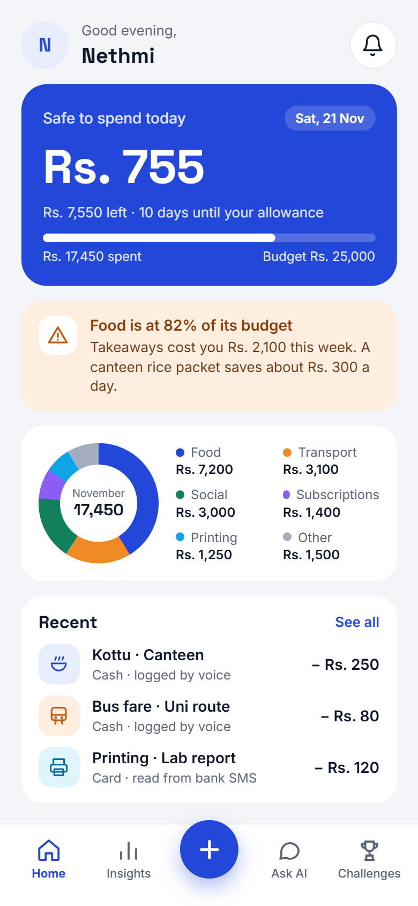
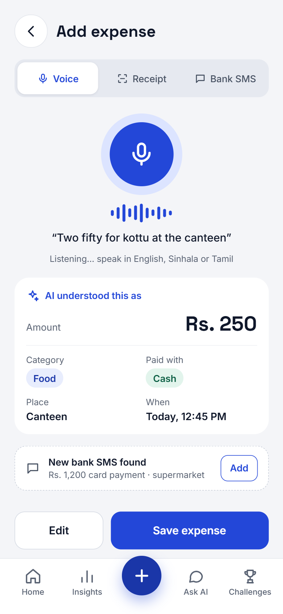
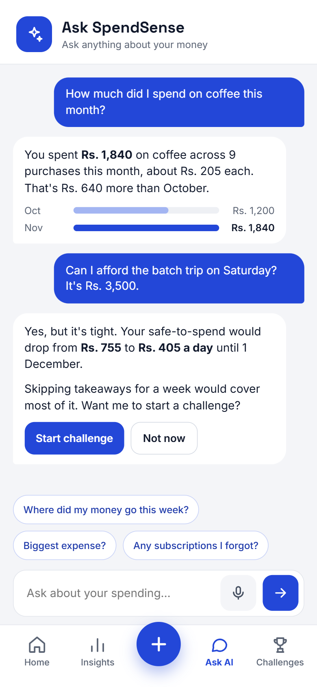
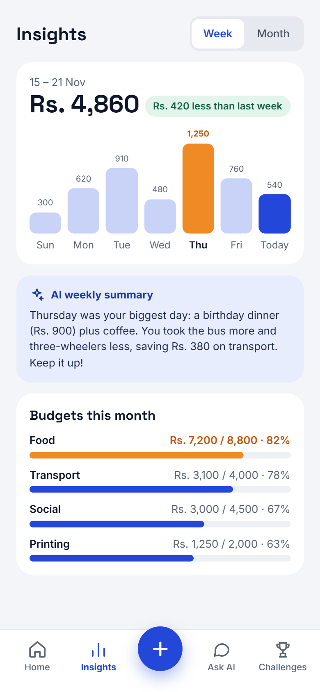
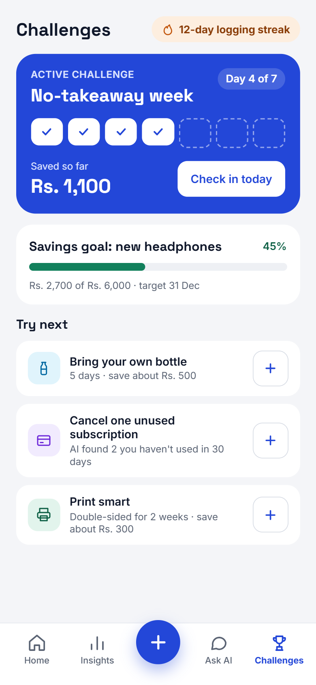

# Lab 02 - AI in Everyday Challenges

## Laboratory Session

**Lab Number:** 02  
**Title:** AI in Everyday Challenges  
**Type:** Group activity (2 members)  
**Group:** Group 8 - The Budget-Challenged Student  
**Product:** SpendSense

## Objective

The objective of this lab is to apply LLMs to an everyday challenge faced by students. Using an LLM as a product-development partner helps to improve critical thinking, problem solving and creativity, and shows how AI can be applied in a real-world situation.

## The Challenge

> Students have many small expenses every day - food, transportation, subscriptions, coffee, shopping, printing and social activities. Small purchases can quickly add up, making it difficult to understand where their money is going. Design a product that helps students understand, control and manage their spending.

We had to use an LLM as our product-development partner and create a **product concept, name, key features, target user and a visual prototype/mock-up**, and then present it to the class in 2-3 minutes.

## Tasks and Implementation

| Step | Task | What we did | Evidence |
|------|------|-------------|----------|
| 1 | Problem research | Asked the LLM to act as a UX researcher and list the top 10 spending problems for university students in Sri Lanka, and why existing apps do not solve them. | [Screenshot](screenshots/01-problem-research.png) |
| 2 | Idea generation | Asked for 6 AI product ideas with the role of AI and how feasible each one is. We combined the best ideas into one app. | [Screenshot](screenshots/02-idea-generation.png) |
| 3 | Idea critique | Asked the LLM to find the weaknesses in our chosen idea and suggest fixes. | [Screenshot](screenshots/03-idea-critique.png) |
| 4 | Persona | Created a target user persona and a one-day user journey. | [Screenshot](screenshots/04-persona.png) |
| 5 | Naming | Asked for 10 names with taglines. We chose our own name, SpendSense. | [Screenshot](screenshots/05-naming.png) |
| 6 | Mock-up | Described each screen and used an AI design tool to draft five app screens, then reviewed and edited them. | [Mock-ups](#mock-up) |
| 7 | Presentation | Prepared and presented the problem, product, development process and how we used the LLM. | [Slides (PDF)](SpendSense-presentation.pdf) |

The group activity is documented in the [group-activity](group-activity/) folder:

- [Group Members](group-activity/group-members.md) - names, IDs and who did what
- [Activity Outcomes](group-activity/activity-outcomes.md) - problem, concept, features, target user and mock-up
- [Discussion Summary](group-activity/discussion-summary.md) - decisions made and points discussed

## Results and Evidence

### Product: SpendSense - *"Know where your money goes."*

SpendSense is an AI mobile app that tracks and explains student spending so the money lasts the month. Students log spending by voice, receipt or bank SMS, the AI sorts it into categories, and the app shows one simple number every day: how much they can safely spend today.

**Key features**

1. **Say it, snap it** - log cash by voice in Sinhala, Tamil or English, or scan a receipt
2. **Auto-categorise** - AI sorts spending into food, transport, printing, social and more
3. **Safe to spend today** - one daily number: money left ÷ days until the next allowance
4. **Ask your money** - a chat to ask questions like "Can I afford the trip?"
5. **Nudges and challenges** - early warnings, savings goals and streaks

**Target user:** Sri Lankan undergraduates aged 18-25 living on a monthly allowance, represented by our persona *Nethmi Perera*: *"I don't spend on anything big, but the money is always gone by the 20th."*

### Mock-up

| Home | Add Expense | Ask AI | Insights | Challenges |
|------|-------------|--------|----------|------------|
|  |  |  |  |  |

### Presentation

The final slides are available here: [SpendSense-presentation.pdf](SpendSense-presentation.pdf)

## Observations

- **The LLM was fast and creative.** Research, product ideas and names that would normally take hours were done in minutes.
- **Context changed the quality of the answers.** The answers became much more specific and useful once we mentioned Sri Lanka, Mahapola and cash payments.
- **The critique step was the most useful.** The LLM pointed out problems we had not thought about, such as Google Play restricting SMS access and iOS not allowing it at all. Because of this we changed our plan to use notification access, "share SMS" and voice logging instead of relying only on SMS.
- **The answers were hypotheses, not facts.** The LLM itself said its problem list was based on known patterns and not on real interviews, so it would need to be tested with real students.
- **We could not use the output directly.** We had to choose, combine and check the answers against our own experience as students. For example, we combined several ideas into one app and chose our own name instead of the suggested ones.
- **Privacy is a concern.** The app works with financial data, so privacy would need to be designed in from the start.

## Learning Outcomes

- Learned how to use an LLM as a product-development partner for research, idea generation, critique, persona creation and naming.
- Understood that giving the LLM clear context and a role (e.g. "act as a UX researcher") leads to more specific and useful answers.
- Learned to critically evaluate LLM output instead of accepting it, and to treat its research as assumptions that need testing.
- Gained experience in turning an everyday problem into a product concept with features, a target user and a visual mock-up.
- Improved teamwork and presentation skills by working in a pair and presenting the final product to the class.
